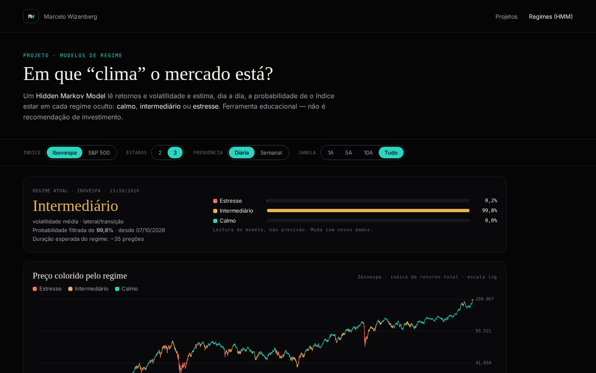

# Regimes de mercado (HMM) — Ibovespa e S&P 500

Ferramenta **educacional** que estima, com um *Hidden Markov Model* gaussiano, em que regime de mercado (calmo, intermediário ou estresse) o Ibovespa e o S&P 500 estão — e estiveram desde 2000.

**▶ Abrir o app: [celowiz.github.io/hmm-regimes](https://celowiz.github.io/hmm-regimes/)**

[](https://celowiz.github.io/hmm-regimes/)

> Conteúdo educacional. Não constitui recomendação de investimento.

## O que mostra
- Preço colorido pelo regime mais provável e probabilidades empilhadas ao longo do tempo
- Matriz de transição, duração esperada × observada e estatísticas por regime (retorno, vol, drawdown, % do tempo)
- Regime atual com probabilidade, seletores de índice, nº de estados (2/3), frequência (diária/semanal) e janela
- Momentos históricos de cada mercado e comparação didática filtrada × suavizada

## Modelo
- **Dados:** Yahoo Finance via `yfinance`, desde 2000. Ibovespa `^BVSP` (já é índice de retorno total) e S&P 500 `^GSPC` (índice de preço — histórico mais longo e nível acompanhado por todos; dividendos de ~1,5–2% a.a. ficam de fora, com pouco efeito na volatilidade que define os regimes).
- **Entradas:** retorno log e volatilidade realizada (21 pregões na diária, 8 semanas na semanal), padronizados.
- **Ajuste:** `hmmlearn.GaussianHMM` com covariância completa, 5 sementes fixas, fica o maior log‑likelihood.
- **Rótulos:** pela volatilidade do estado (maior = estresse, menor = calmo).
- **Probabilidades exibidas:** *filtradas* (recursão forward, só usam dados até cada data). As suavizadas usam o futuro e aparecem apenas para comparação.

## Limites
- Parâmetros estimados com todo o histórico (*in‑sample*): mesmo a filtrada tem viés retrospectivo.
- Regimes mudam com atraso e dependem de escolhas do modelador (nº de estados, janelas, rótulos).
- Um regime de estresse pode ter retorno médio positivo por causa de repiques fortes.

## Atualização
GitHub Actions (`.github/workflows/pages.yml`) roda testes, baixa dados, reajusta os modelos e publica no GitHub Pages a cada push e de segunda a sexta às 19:13 (horário de Brasília), com crons reserva às 21:13 e às 08:23 do dia seguinte que só refazem o build se o site publicado ainda não tiver o último pregão (data dos dados, `as_of`). O download do Yahoo tem novas tentativas com espera crescente. Candles do dia antes das 18:30 BRT são descartados.

O job também grava `data/summary.json` (`scripts/summary.py`, ~2 KB): regime atual do modelo diário de 3 estados, probabilidade, data de início e a faixa dos últimos 60 pregões para Ibovespa e S&P 500. É o que a página [Mercado Hoje](https://celowiz.github.io/mercado-hoje/) do portfólio lê.

## Rodar localmente
```bash
pip install -r requirements.txt
python -m pytest -q tests
python scripts/build_hmm.py data
python scripts/summary.py data
python -m http.server 8000
```

## Licença
Código sob licença [MIT](LICENSE). Dados do Yahoo Finance seguem os termos da fonte.
